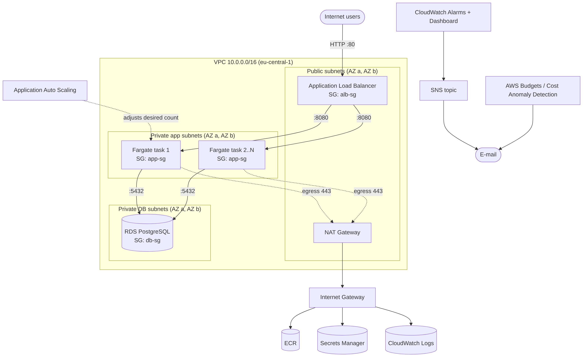
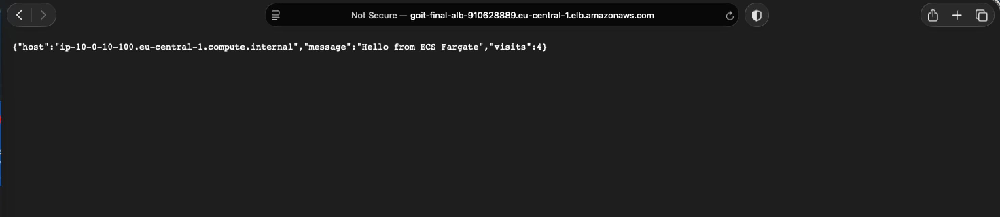
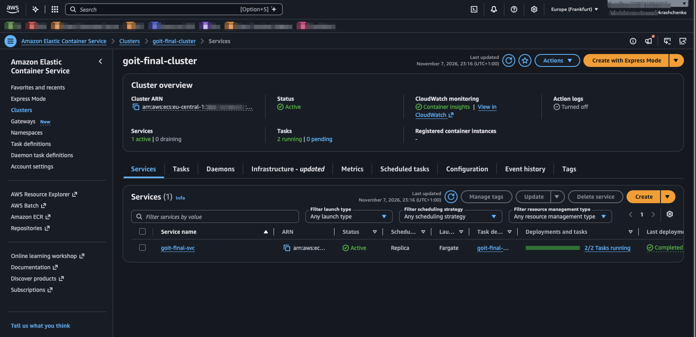
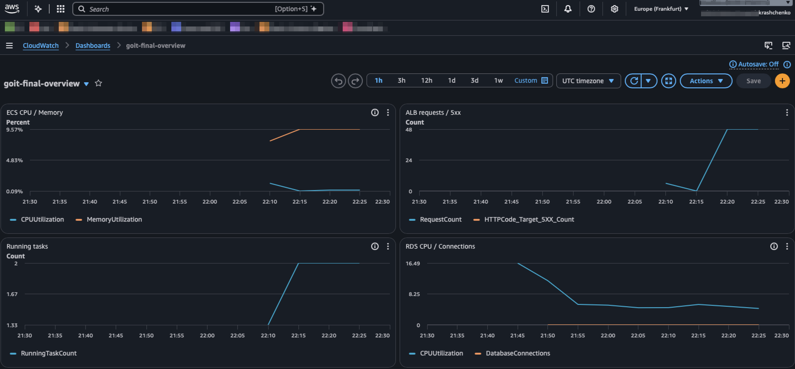
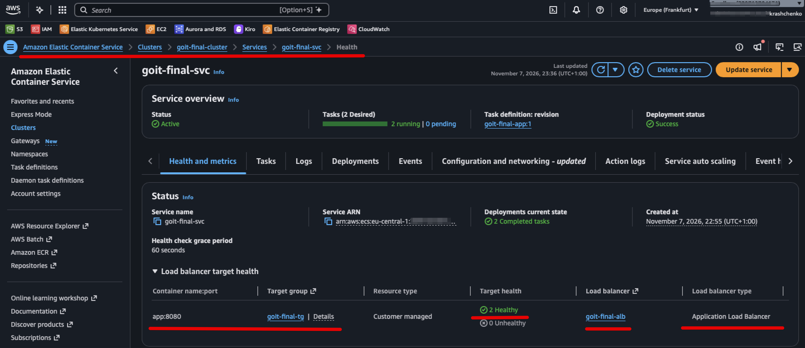
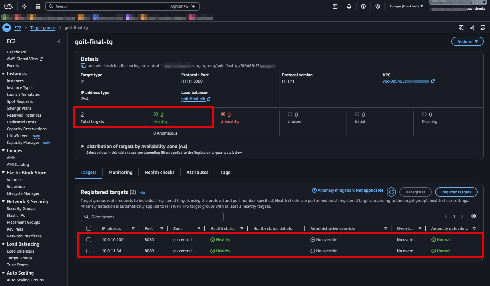
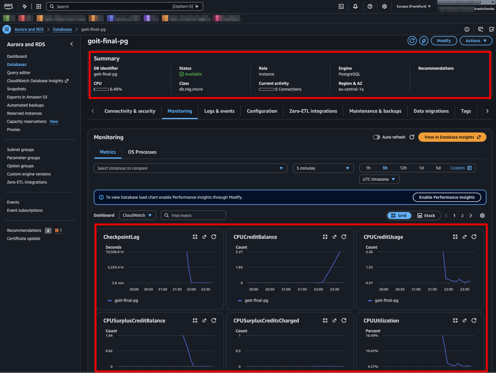
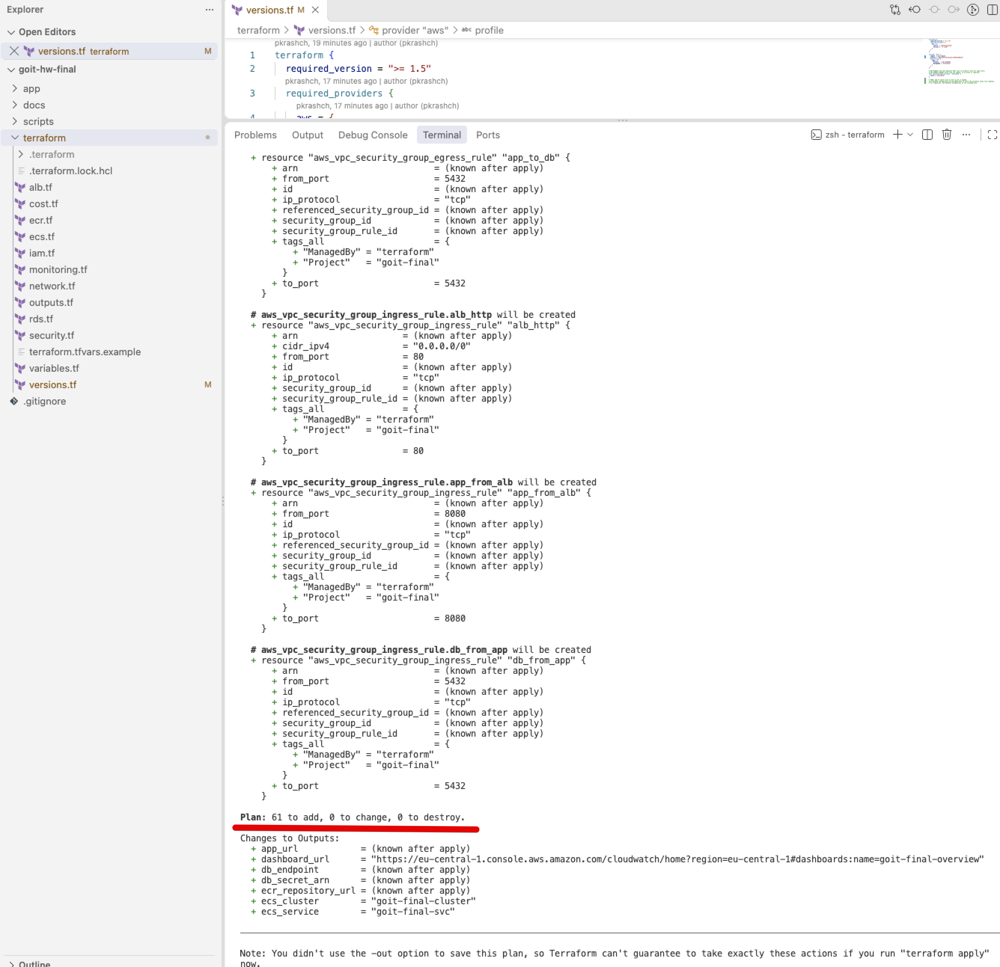
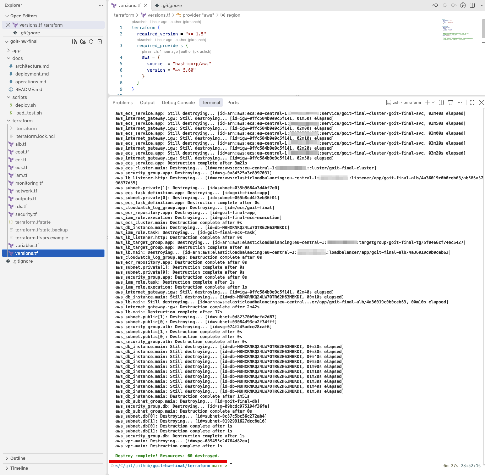

# Фінальний проєкт: вебзастосунок в AWS (ECS Fargate + RDS PostgreSQL)

Flask-застосунок у контейнерах **Amazon ECS на AWS Fargate** за **Application Load Balancer**, з базою **Amazon RDS PostgreSQL**, моніторингом **CloudWatch + SNS**, **Application Auto Scaling** і контролем витрат через **AWS Budgets / Cost Explorer**. Уся інфраструктура описана в Terraform і розгортається однією командою.

📄 **Файл здачі:** [`ФП_Кращенко_Поліна.txt`](ФП_Кращенко_Поліна.txt)



## Відповідність критеріям прийняття

| Критерій | Реалізація | Доказ |
|---|---|---|
| Середовище з обґрунтованою архітектурою | ECS Fargate, 3 рівні підмереж у 2 AZ | [architecture.md](docs/architecture.md), [схема](docs/screenshots/00_architecture_diagram.png), [кластер](docs/screenshots/04_ecs_cluster_overview.png) |
| Безпека: VPC, IAM, Security Groups | Public / private-app / private-db підмережі, SG-to-SG правила, дві IAM-ролі з мінімальними правами | [`network.tf`](terraform/network.tf), [`security.tf`](terraform/security.tf), [`iam.tf`](terraform/iam.tf), [plan з правилами SG](docs/screenshots/02_terraform_plan_security_groups.png) |
| База даних | RDS PostgreSQL 16, ізольовані підмережі, шифрування, пароль у Secrets Manager | [`rds.tf`](terraform/rds.tf), [скриншот RDS](docs/screenshots/08_rds_postgresql.png) |
| Застосунок доступний за публічним URL | ALB DNS, лічильник відвідувань з БД | [відповідь застосунку](docs/screenshots/03_app_public_url.png) |
| Моніторинг CloudWatch та алерти | Дашборд, Container Insights, логи, 8 алармів → SNS → e-mail | [`monitoring.tf`](terraform/monitoring.tf), [дашборд](docs/screenshots/05_cloudwatch_dashboard.png) |
| Автомасштабування та балансування | ALB + health check; target tracking за CPU 50% і 500 запитів/задачу, 2–6 задач | [`alb.tf`](terraform/alb.tf), [`ecs.tf`](terraform/ecs.tf), [сервіс за ALB](docs/screenshots/06_ecs_service_alb.png), [цілі у 2 AZ](docs/screenshots/07_target_group_two_az.png) |
| Оптимізація витрат | AWS Budget з 3 порогами, аналіз у Cost Explorer за тегом `Project`, видалення стеку після демо | [`cost.tf`](terraform/cost.tf), [operations.md](docs/operations.md#cost-optimization), [destroy](docs/screenshots/09_terraform_destroy.png) |
| Опис вибору архітектури й технологій | Порівняння з EKS, EC2, Elastic Beanstalk, DynamoDB | [architecture.md](docs/architecture.md#2-technology-justification) |

## Швидкий старт

```bash
cp terraform/terraform.tfvars.example terraform/terraform.tfvars   # вказати alert_email
./scripts/deploy.sh                                                # ECR → docker push → terraform apply
./scripts/load_test.sh "$(terraform -chdir=terraform output -raw app_url)" 300 30
terraform -chdir=terraform destroy                                 # зупинити витрати
```

## Структура репозиторію

| Шлях | Призначення |
|---|---|
| `app/` | Flask-застосунок і Dockerfile |
| `terraform/` | Уся інфраструктура AWS як код |
| `scripts/deploy.sh` | Деплой у три фази |
| `scripts/load_test.sh` | Навантажувальне тестування для перевірки автомасштабування |
| `docs/` | [Архітектура](docs/architecture.md), [деплой](docs/deployment.md), [моніторинг, масштабування, витрати](docs/operations.md) |
| `docs/screenshots/` | Скриншоти розгортання |

## Скриншоти

| | |
|---|---|
| **Застосунок за публічним URL**  | **ECS-кластер**  |
| **CloudWatch-дашборд**  | **Сервіс за ALB**  |
| **Target group, 2 AZ**  | **RDS PostgreSQL**  |
| **terraform plan**  | **terraform destroy**  |
