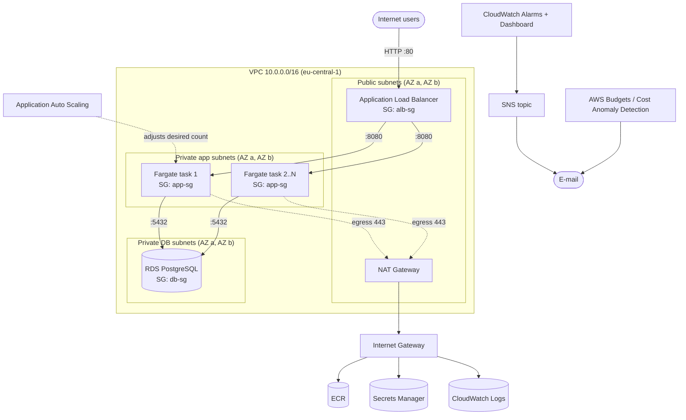

# Architecture and Technology Choices

## 1. Environment description

The application runs on **Amazon ECS with AWS Fargate** (serverless containers) in region `eu-central-1`.

| Layer | Service | Notes |
|-------|---------|-------|
| Entry point | Application Load Balancer (ALB) | Public, HTTP :80, spans 2 AZs |
| Compute | ECS Fargate service | 2-6 tasks, 0.25 vCPU / 512 MiB each, private subnets |
| Image registry | Amazon ECR | Scan on push, lifecycle policy (keep 10 images) |
| Database | RDS PostgreSQL 16 (`db.t4g.micro`) | Isolated DB subnets, encrypted at rest |
| Secrets | AWS Secrets Manager | RDS-managed master password, injected into the container |
| Network | VPC 10.0.0.0/16 | Public, private-app and private-db subnets in 2 AZs |
| Observability | CloudWatch Logs, Metrics, Alarms, Dashboard, Container Insights | |
| Alerting | SNS topic with e-mail subscription | Alarms and budgets |
| Scaling | Application Auto Scaling | Target tracking on CPU and ALB requests per target |
| Cost | AWS Budgets, Cost Explorer anomaly detection | |

## Architecture diagram



Traffic flow (text version):

```
Internet -> ALB (public subnets) -> Fargate tasks (private subnets) -> RDS (isolated subnets)
Tasks -> NAT Gateway -> ECR / Secrets Manager / CloudWatch (outbound only)
```

## 2. Technology justification

**ECS on Fargate** instead of EKS/EC2/Elastic Beanstalk:
- No servers to patch or size, so the team manages only the task definition.
- EKS control plane costs ~$73/month, which is too expensive for a Free plan account. Fargate has no fixed fee.
- Compared with Elastic Beanstalk, ECS is container-native, gives explicit control over networking and IAM, and is closer to what is used in production.
- Compared with raw EC2, there is no OS management and scaling is a single policy.

**RDS PostgreSQL** instead of DynamoDB:
- The demo data model is relational and SQL is the most common skill set.
- RDS provides backups, encryption, and patching. `db.t4g.micro` keeps cost low.
- DynamoDB would also be valid, but would not demonstrate subnet/SG isolation of a database as clearly.

**Flask + Gunicorn**: minimal footprint, one file, easy to read and to load-test (`/load` endpoint burns CPU on purpose).

**Terraform**: reproducible, reviewable, and removable with one `terraform destroy`, which matters for cost control. (The assignment mentions the AWS Console; Terraform creates exactly the same resources, and the console can be used to inspect and demonstrate them.)

## 3. Security design

### VPC and subnets
- Three tiers across 2 AZs: **public** (ALB, NAT), **private-app** (Fargate), **private-db** (RDS).
- DB subnets have **no route to the internet** (local route only).
- Tasks have no public IP; outbound traffic goes through a NAT gateway.

### Security Groups (least privilege, SG-to-SG references)

| SG | Inbound | Outbound |
|----|---------|----------|
| `alb-sg` | TCP 80 from 0.0.0.0/0 | TCP 8080 to `app-sg` |
| `app-sg` | TCP 8080 from `alb-sg` only | TCP 443 to internet (via NAT), TCP 5432 to `db-sg` |
| `db-sg` | TCP 5432 from `app-sg` only | none |

### IAM roles
- **Task execution role**: AWS managed `AmazonECSTaskExecutionRolePolicy` plus `secretsmanager:GetSecretValue` on **one** secret ARN.
- **Task role**: identity of the application code, with no permissions (the app does not call AWS APIs).
- No long-lived access keys are used by the workload.

### Database access and passwords
- `manage_master_user_password = true`: RDS generates the password and stores it in Secrets Manager. It is **never in Terraform code, variables, or logs** (note: it can appear in the Terraform state for some attributes, so keep state private).
- ECS injects `DB_USER`/`DB_PASSWORD` as container secrets at start time.
- Connections use `sslmode=require`; storage is encrypted; DB is not publicly accessible.
- Connection optimization: Gunicorn runs a fixed small number of workers, so total connections stay bounded (`tasks x workers`), well under the `db.t4g.micro` limit. An alarm fires on high connection count. For larger scale, add RDS Proxy.

## 4. Known limitations (deliberate, for cost)
- HTTP only on the ALB. For production add an ACM certificate and an HTTPS listener with redirect.
- Single NAT gateway (`single_nat_gateway = true`) is a single point of failure for outbound traffic. Set to `false` for HA.
- RDS single-AZ (`db_multi_az = false`). Set to `true` for HA.
- Terraform state is local. For teams use an S3 backend with DynamoDB locking.
